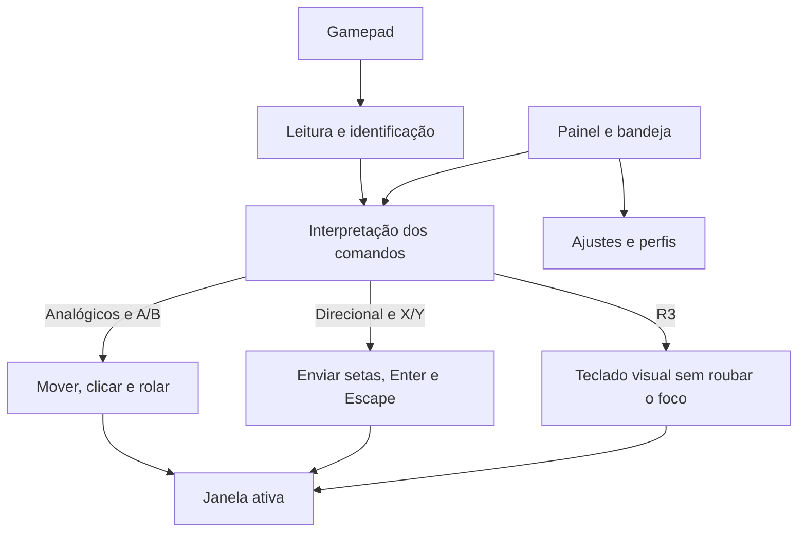

# Como o Gamepad Desktop funciona

O Gamepad Desktop permite controlar a janela ativa com um gamepad. Ele é um aplicativo independente da extensão de navegador: trabalha no desktop e pode ser usado com navegadores e outros programas, conforme o suporte de cada um.

## A experiência em poucas palavras

1. Conecte um controle e abra o painel do Gamepad Desktop.
2. Use o analógico para apontar, o direcional para enviar setas e os botões para clicar ou enviar atalhos.
3. Abra o teclado visual quando precisar digitar. Ele envia as teclas ao aplicativo que já estava ativo.
4. Recolha o painel para a bandeja para continuar usando o controle em segundo plano.

O analógico esquerdo move o ponteiro e o direcional envia as setas ao aplicativo ativo. Não há navegação por itens acessíveis.

## Visão do sistema

O controle envia botões e movimentos para o app. O app interpreta cada comando e encaminha a ação ao sistema operacional. O painel apresenta o estado e os ajustes; a bandeja permite ocultá-lo sem parar o controle.



### Partes do sistema

| Parte               | O que faz                                                                                              |
| ------------------- | ------------------------------------------------------------------------------------------------------ |
| Leitura do controle | Detecta controles conectados, botões e analógicos. Reconecta quando um dispositivo é removido.         |
| Interpretação       | Converte o estado do controle em movimento, cliques, rolagem, teclas e comandos de pausa.              |
| Mouse e teclado     | Controla o ponteiro, cliques, arrasto, rolagem, setas e atalhos do sistema.                             |
| Teclado visual      | Mostra um teclado controlado pelo gamepad e envia cada tecla para o aplicativo ativo.                  |
| Painel e bandeja    | Mostra o estado, permite ajustar o app e mantém o controle em execução quando o painel é recolhido.    |

No código, esses fluxos se concentram em `src/gamepads.rs`, `src/control.rs`, `src/runtime.rs`, `src/keyboard.rs`, `src/linux.rs`, `src/windows.rs`, `src/main.rs` e `src/tray.rs`.

## Mouse e teclado

### Mouse

O analógico esquerdo move o ponteiro e o direito rola a página. A oferece clique e arrasto; B oferece clique direito. O direcional envia setas, X envia Enter e Y envia Escape. L3 envia Super/Windows, L1 envia Tab e R1 abre o seletor de janelas; repita R1 para avançar, X confirma e Y cancela.

A velocidade do ponteiro e a zona morta podem ser ajustadas no painel. Esses ajustes valem para a sessão.

### Teclado visual

Pressione **R3** — o analógico direito — para abrir ou fechar o teclado. O direcional move a seleção e o botão inferior digita. Os demais botões fazem Backspace, Enter, Escape, espaço, Tab ou alternam Shift.

O teclado usa o desenho QWERTY ANSI e mantém o foco no aplicativo anterior. Quando o aplicativo informa a posição do campo focado, o teclado tenta aparecer perto dele; caso contrário, usa a posição configurada no painel. O app consulta apenas a geometria do campo, não o texto digitado.

O teclado também tem ajustes próprios: largura, posição, opacidade e repetição do direcional. Com ele aberto, **Start** abre a tela de ajustes; Start retorna à digitação e salva. R3 fecha e salva. Ctrl, Alt e Super combinam com a próxima tecla; Shift vale para a próxima tecla e Caps mantém maiúsculas.


## Controles

Os rótulos abaixo descrevem também as posições físicas dos quatro botões frontais. O painel mostra os nomes correspondentes para Xbox, PlayStation e Switch.

| Comando                        | Ação                                   |
| ------------------------------ | -------------------------------------- |
| Analógico esquerdo             | Mover ponteiro                         |
| Analógico direito, cima/baixo  | Rolar                                  |
| Direcional                     | Enviar setas; segurar para repetir      |
| Inferior — A / ✕ / B no Switch | Clique esquerdo; segurar para arrastar |
| Direito — B / ○ / A no Switch  | Clique direito                         |
| Esquerdo — X / □ / Y no Switch | Enter                                   |
| Superior — Y / △ / X no Switch | Escape                                  |
| R3                             | Abrir ou fechar teclado                |
| L3                             | Super / tecla Windows                  |
| LB / L1                        | Tab                                    |
| RB / R1                        | Abre o seletor Alt+Tab; R1 avança; X confirma; Y cancela |
| Segure Start/Menu + LB / L1    | Print Screen · inicia a captura do sistema |
| Segure Start/Menu + RB / R1    | F11 · alternar tela cheia              |
| Start + Select / Menu + View   | Pausar ou retomar; solte e centralize para retomar |

No teclado visual, o botão inferior digita a tecla selecionada; o direito apaga; o esquerdo envia Enter; o superior envia Escape; L3 envia espaço; L1 envia Tab; R1 alterna Shift.

Escape cancela menus ou diálogos. Ele não volta no histórico do navegador.

## Controles e perfis

O modo automático escolhe um controle reconhecido com perfil e procura novamente quando ele desconecta. Também é possível selecionar um dispositivo no painel. A seleção explícita vale para a sessão; se o controle for desconectado, selecione-o novamente após reconectar.

Controles conhecidos usam os perfis disponíveis. Se o app detectar um modelo sem perfil, ele aparece no seletor e o painel permite importar uma linha de mapeamento. O perfil importado é salvo para próximas sessões. Um assistente visual para configurar controles desconhecidos está no [roadmap](roadmap.md).

Depois de conectar, reconectar ou retomar, solte os botões e centralize os analógicos. Pausar, desconectar ou encerrar o app libera cliques que estejam sendo mantidos.

## Painel e bandeja

O painel informa se o controle foi reconhecido, qual modo está ativo e se o app está pausado. Ele também concentra seleção de controle, velocidade, zona morta, perfis e personalização do teclado.

Fechar ou recolher o painel mantém o controle funcionando na bandeja, perto do relógio, quando o ambiente oferece essa área. Use **Abrir painel**, **Recolher painel** ou **Encerrar aplicativo** no menu da bandeja. Se a bandeja não puder ser criada, o painel avisa e fechar a janela encerra o app para que ele não fique inacessível.

## Integração com cada sistema

| Sistema       | Ponteiro e teclas                                                    | Teclado visual                                                             |
| ------------- | -------------------------------------------------------------------- | -------------------------------------------------------------------------- |
| Windows       | Entrada nativa do Windows                                            | Janela transparente, sempre no topo, sem ativação e com cliques repassados |
| Linux/X11     | Dispositivos virtuais de entrada                                     | Janela transparente, sem ativação e com cliques repassados                 |
| Linux/Wayland | Dispositivos virtuais, sujeitos a permissões e ao compositor         | Camada `wlr-layer-shell`, sem foco de teclado e sem região de mouse        |

### Windows

O Windows pode bloquear entrada enviada a aplicativos executados com privilégios mais altos que o Gamepad Desktop.

### Linux

O mouse e o envio de teclas usam `uinput`, que depende do acesso aos dispositivos de entrada e a `/dev/uinput`. O app não altera essas permissões automaticamente. No Linux, AT-SPI também pode informar a posição do campo focado para posicionar o teclado visual.

Em Wayland, o teclado visual requer que o compositor ofereça `wlr-layer-shell`. O GNOME Wayland não oferece esse protocolo, então o app informa que o teclado visual não está disponível. Alguns aplicativos não publicam coordenadas globais confiáveis; nesses casos o teclado usa a posição manual escolhida no painel.

No Linux, o teclado envia códigos de tecla QWERTY US. O layout do sistema interpreta esses códigos; portanto, teclas especiais e acentos podem não corresponder ao desenho ANSI.

## Como iniciar no Linux

Ainda não há instalador Linux. Para executar a partir deste repositório, instale Rust, CMake e um compilador C/C++ e rode na raiz:

```sh
cargo run --manifest-path desktop/Cargo.toml
```

A sessão também precisa permitir acesso ao controle e aos dispositivos de entrada usados pelo app. A compilação padrão inclui SDL3 a partir do código-fonte. Com SDL3 instalada no sistema, é possível compilar sem essa inclusão usando `--no-default-features`.

## Preferências e execução

As preferências do teclado são salvas entre execuções em `~/.config/gamepad-navigator/keyboard.json` (ou sob `$XDG_CONFIG_HOME`) no Linux e em `%APPDATA%/gamepad-navigator/keyboard.json` no Windows.

Para gerar uma prévia do teclado com o renderizador real no Linux:

```sh
cargo run --manifest-path desktop/Cargo.toml --example keyboard_preview
```

Os arquivos PPM gerados vão para `/tmp/gamepad-keyboard-preview`.

## Estado e limites conhecidos

- Mouse, entrada por teclado e teclado visual estão implementados. Ainda precisam de validação física em Windows 11, Linux/X11 e outros compositores Wayland.
- O suporte às setas depende do aplicativo ativo. Ainda não há uma matriz publicada de compatibilidade por aplicativo.
- O teclado tem desenho QWERTY ANSI. No Linux, layouts diferentes podem produzir símbolos diferentes e o suporte a caracteres acentuados ainda precisa ser validado.
- O teclado visual em Wayland não está disponível em compositores sem `wlr-layer-shell`.
- Os pacotes Windows e Linux x64 são anexados às releases do Gamepad Desktop. O build não substitui a validação com controle físico em cada sistema.
- A pesquisa e as decisões do teclado estão em [keyboard-research.md](keyboard-research.md); o que falta concluir está em [roadmap.md](roadmap.md).

## Mapa interno

| Arquivo                                     | Responsabilidade                                     |
| ------------------------------------------- | ---------------------------------------------------- |
| `src/main.rs`                               | Painel, comandos e ciclo de vida da janela           |
| `src/gamepads.rs`                           | Detecção, seleção e perfis dos controles             |
| `src/control.rs`                            | Mapeamento dos botões e analógicos para comandos     |
| `src/runtime.rs`                            | Loop de controle que continua ativo em segundo plano |
| `src/focused_input.rs` e `src/placement.rs` | Geometria do campo focado e posição do teclado       |
| `src/keyboard.rs`                           | Teclas, ajustes e estado de digitação                |
| `src/linux.rs` e `src/windows.rs`           | Integração específica com os sistemas                |
| `src/wayland_keyboard.rs`                   | Camada do teclado visual no Wayland                  |
| `src/tray.rs`                               | Ícone e comandos da bandeja                          |

## Validação

Os comandos de qualidade do app são:

```sh
cargo test --manifest-path desktop/Cargo.toml
cargo fmt --manifest-path desktop/Cargo.toml --check
cargo clippy --manifest-path desktop/Cargo.toml --all-targets -- -D warnings
```

Os testes de integração com dispositivos físicos são optativos e dependem de permissões, `/dev/uinput` e de um controle conectado. A validação manual deve incluir navegação, foco, digitação, recuperação após desconexão e uso da bandeja em cada ambiente-alvo.

## Referências

- [UI Automation no Windows](https://learn.microsoft.com/en-us/windows/win32/winauto/entry-uiautocore-overview)
- [AT-SPI2 no Linux](https://wiki.freedesktop.org/www/Accessibility/AT-SPI2/)
- [SDL3: controles e perfis](https://wiki.libsdl.org/SDL3/CategoryGamepad)
- [Protocolo `wlr-layer-shell`](https://wayland.app/protocols/wlr-layer-shell-unstable-v1)
- [Dispositivos virtuais `uinput`](https://docs.rs/evdev/latest/evdev/uinput/)
- [Pesquisa do teclado visual](keyboard-research.md)
- [Roadmap do projeto](roadmap.md)
