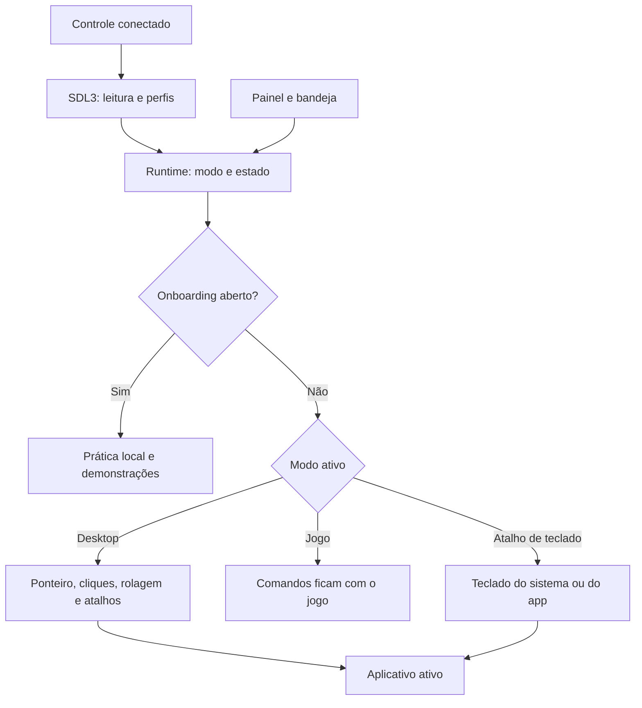

# Como o Gamepad Desktop funciona

O Gamepad Desktop é um aplicativo Rust para Windows e Linux. Ele lê o gamepad em segundo plano e transforma seus comandos em entrada para o aplicativo ativo. O painel serve para aprender os comandos, configurar e acompanhar o estado.

Para instalar e usar, consulte o [guia do desktop](../README.md). Para compilar, consulte [desenvolvimento](development.md).

## Fluxo de entrada



A navegação comum usa ponteiro e atalhos. O app não enumera elementos acessíveis para escolher o próximo botão de uma janela. A leitura de acessibilidade usada pelo teclado próprio consulta a geometria do campo focado, sem ler seu texto.

## Modos e recuperação

- **Desktop:** analógicos e botões controlam mouse e teclado; Start + Select pausa ou retoma.
- **Jogo:** a entrada comum fica com o jogo. Select + R3 abre o teclado sem transformar o restante dos comandos em mouse.
- **Troca de modo:** dois toques rápidos em Select / View alternam Desktop e Jogo.
- **Teclado aberto:** R3 solicita o fechamento nos dois modos.

Conectar, reconectar, trocar de modo ou retomar exige soltar os botões e centralizar os analógicos. Desconexão e encerramento liberam cliques mantidos. O comportamento de cada gesto está em [`control.rs`](../src/control.rs).

## Onboarding

O percurso principal reúne cinco grupos: mouse, rolagem, teclado, modos e conclusão. Abrir, digitar e fechar o teclado são práticas distintas dentro do mesmo grupo. O usuário avança explicitamente; concluir uma prática ou uma demonstração não troca de lição sozinho.

Clique direito, arrasto, seletor de janelas, captura/tela cheia e pausa têm um percurso opcional próprio, acessível por **Aprender mais**. Voltar e continuar seguem o percurso atual.

As práticas usam os mesmos mapeamentos, mas consomem suas ações localmente. O teclado da demonstração compartilha o renderizador do teclado próprio. Ele não representa todos os layouts nativos do Windows ou COSMIC.

## Integração por plataforma

| Ambiente       | Entrada comum                                                   | Teclado                                                                       |
| -------------- | --------------------------------------------------------------- | ----------------------------------------------------------------------------- |
| Windows        | Entrada nativa; filtro de teclas virtuais de gamepad no Desktop | Teclado de toque do Windows, com tentativa de layout Gamepad                  |
| Linux/X11      | Mouse e teclado virtuais via `uinput`                           | Viewport próprio sem ativação                                                 |
| COSMIC/Wayland | Mouse e teclado virtuais via `uinput`                           | Serviço `cosmic-osk`, quando disponível; alternativa própria quando suportada |
| Outros Wayland | Mouse e teclado virtuais via `uinput`                           | Camada própria, quando há `wlr-layer-shell`                                   |

### Windows

O app acompanha a visibilidade do teclado por `IFrameworkInputPane`. Aberturas e fechamentos são serializados para acompanhar as animações. Quando o layout Gamepad foi aceito, o fechamento tenta `CoreInputView.TryHide`; se o pedido não for aceito, usa a alternativa de alternância do sistema.

Durante a sessão de teclado nativo, o backend evita duplicar as entradas do controle. Fora dela, o filtro do Desktop bloqueia a faixa de teclas virtuais de gamepad do Windows, mas não bloqueia programas que leem o dispositivo diretamente. Os detalhes e a verificação manual estão em [windows-gamepad-navigation.md](windows-gamepad-navigation.md).

O Windows pode rejeitar entrada enviada para programas com privilégios maiores que o app. Os layouts compacto e grande precisam de validação física, inclusive para confirmar o fechamento com R3.

### Linux

`uinput` exige acesso a `/dev/uinput` e aos dispositivos usados pelo app. Essas permissões não são alteradas automaticamente.

No COSMIC, as ações `show`/`hide` do serviço nativo controlam o teclado. O app evita injetar uma segunda sequência de digitação. Mudanças externas e abertura automática ainda precisam de validação.

O teclado próprio em Wayland requer `wlr-layer-shell`. O GNOME Wayland não oferece esse caminho. AT-SPI fornece a posição do campo quando ela é confiável; na ausência dela, o teclado usa a posição configurada. O desenho é QWERTY US e os códigos enviados são interpretados pelo layout do sistema.

## Painel, preferências e encerramento

O painel informa conexão, modo, pausa, falhas e versão. A bandeja permite recolher, reabrir ou encerrar. Sem bandeja disponível, fechar o painel encerra o processo para evitar uma sessão inacessível.

As preferências ficam em `gamepad-navigator/preferences.json` e `gamepad-navigator/keyboard.json`, sob `$XDG_CONFIG_HOME` ou `~/.config` no Linux e `%APPDATA%` no Windows. O nome dessa pasta preserva a compatibilidade com versões anteriores.

A interface inicia em 125%. O cursor inicia em 100% do tamanho encontrado no sistema e só é alterado quando a preferência de escala exige. A personalização do cursor é persistida após uma alteração explícita; preferências antigas com o padrão de 135% são normalizadas.

Encerrar solicita a parada do worker de entrada e aguarda sua conclusão. Esse caminho inclui limpeza das entradas, teclado, gravações em andamento e restauração dos cursores. A UI pode mostrar **Finalizando a limpeza antes de fechar…** enquanto espera. A restauração do cursor é repetida em caso de erro; falhas persistentes mantêm o processo aguardando.

## Como iniciar no Linux

Há pacotes `.deb` e `.tar.gz` nas [releases](https://github.com/andrecrjr/GamepadDesktop/releases/latest). As instruções de instalação e permissões estão no [guia de uso](../README.md#linux).

Para compilar e executar, instale as dependências do [guia de desenvolvimento](development.md#executar-localmente) e rode na raiz:

```sh
make desktop-run
```

## Mapa interno

| Arquivo                                                                                                             | Responsabilidade                                |
| ------------------------------------------------------------------------------------------------------------------- | ----------------------------------------------- |
| [`main.rs`](../src/main.rs) e [`tray.rs`](../src/tray.rs)                                                           | Painel, bandeja e ciclo de vida                 |
| [`gamepads.rs`](../src/gamepads.rs)                                                                                 | Leitura SDL3, seleção e perfis                  |
| [`control.rs`](../src/control.rs)                                                                                   | Mapeamentos, modos e recuperação                |
| [`runtime.rs`](../src/runtime.rs)                                                                                   | Worker de entrada, estado e persistência        |
| [`onboarding.rs`](../src/onboarding.rs) e [`onboarding_view.rs`](../src/onboarding_view.rs)                         | Percursos, prática, demonstração e apresentação |
| [`keyboard.rs`](../src/keyboard.rs) e [`keyboard_view.rs`](../src/keyboard_view.rs)                                 | Modelo e desenho do teclado próprio             |
| [`linux.rs`](../src/linux.rs) e [`windows.rs`](../src/windows.rs)                                                   | Adaptadores do sistema                          |
| [`windows_touch_keyboard.rs`](../src/windows_touch_keyboard.rs) e [`cosmic_keyboard.rs`](../src/cosmic_keyboard.rs) | Integrações de teclado nativo                   |
| [`wayland_keyboard.rs`](../src/wayland_keyboard.rs)                                                                 | Camada do teclado próprio em Wayland            |
| [`focused_input.rs`](../src/focused_input.rs) e [`placement.rs`](../src/placement.rs)                               | Geometria e posicionamento do teclado próprio   |
| [`updater.rs`](../src/updater.rs) e [`startup.rs`](../src/startup.rs)                                               | Atualização e início com a sessão               |

Builds e testes automatizados verificam compilação e comportamento modelado. A compatibilidade física por controle, sistema e aplicativo segue no [roadmap](roadmap.md).
